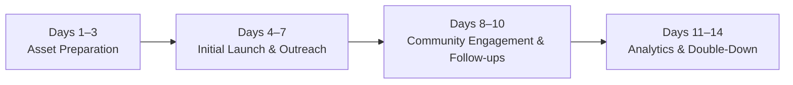

# 20 First-Time Freelancer Invoices: 14-Day Campaign Playbook

> **The Campaign Objective:** Acquire **20 people who actually create and download an invoice** on QuickBillFree within 14 days.  
> **Core Value Proposition:** *"Create your first freelance invoice and download the PDF free. No account needed."*

---

## 📅 14-Day Execution Calendar

### Phase 1: Days 1–3 — Preparation & Production
*All master files are ready in `/marketing/`:*
- [x] **Video Scripts:** [video-demo-scripts.md](file:///Users/sr-lp-01067/Desktop/Projects/untitled%20folder/marketing/video-demo-scripts.md) (3 scripts: First invoice, 50% deposit, Hourly billing)
- [x] **Community Posts:** [community-posts.md](file:///Users/sr-lp-01067/Desktop/Projects/untitled%20folder/marketing/community-posts.md) (3 value-first articles with transparent founder disclosure)
- [x] **Partner Outreach:** [partner-outreach.md](file:///Users/sr-lp-01067/Desktop/Projects/untitled%20folder/marketing/partner-outreach.md) (10 vetted targets + pitch templates)
- [x] **Tracking Matrix:** [utm-tracking-matrix.md](file:///Users/sr-lp-01067/Desktop/Projects/untitled%20folder/marketing/utm-tracking-matrix.md) (Standardized UTMs for every placement)

**Action items for Days 1–3:**
1. Record the 3 screen recordings using the storyboards in `video-demo-scripts.md` (takes ~15 minutes per video using Mac Screen Record or OBS).
2. Generate captions with CapCut / Premiere / TikTok auto-captions.
3. Test a mock invoice download using one UTM link to verify GA4 Realtime event tracking.

---

### Phase 2: Days 4–10 — Launch & Outreach Wave
- **Day 4 (First Video + Subreddit Launch):**
  - Publish Video 1 ("First Freelance Invoice in 30 Seconds") to YouTube Shorts & TikTok.
  - Post Community Article 1 ("The First-Invoice Checklist") in `r/SideProject` and `Indie Hackers`.
  - Send email outreach to Resource Partners 1–3.
- **Day 5 (Hourly Focus + Secondary Communities):**
  - Publish Video 3 ("Hourly vs Fixed Billing Made Simple") on LinkedIn & Reels.
  - Send email outreach to Resource Partners 4–6.
  - Check Reddit thread replies and respond to every commenter helpfully.
- **Day 6 (Deposit Protection):**
  - Publish Video 2 ("How to Invoice an Agreed Project Deposit") to YouTube Shorts & TikTok.
  - Post Community Article 2 in Indie Hackers / Freelance forums.
  - Send email outreach to Resource Partners 7–10.
- **Day 7–8 (Follow-Up & Forum Promo Threads):**
  - Drop the freelance tool link into the weekly `r/freelance` Self-Promotion thread.
  - Send a gentle 1-sentence follow-up to partner newsletter editors who haven't replied.
- **Day 9–10 (Showcase & Directory Submissions):**
  - Submit Show HN on Hacker News: *"Show HN: QuickBillFree – Free client-side invoice maker for solo freelancers (no signup)"*.
  - Answer questions and accept user feedback.

---

### Phase 3: Days 11–14 — Measure, Repeat & Close the 20-Invoice Goal
- **Day 11 (Traffic & Download Audit):**
  - Open GA4 -> Reports -> Acquisition -> Traffic Acquisition -> Filter by `first_invoice`.
  - Count exact `download_invoice_pdf` events by source:
    - YouTube Shorts / TikTok?
    - Reddit?
    - Indie Hackers?
    - Partner Newsletters?
- **Day 12–13 (Double Down on the Winner):**
  - If Video 1 got high views: record a sequel showing how to customize currency (EUR/GBP/CAD/AUD) or add tax calculations.
  - If Reddit drove high engagement: share a breakdown of the most common invoicing questions freelancers asked in the comments.
  - If a newsletter featured the tool: thank the author and provide an updated template pack.
- **Day 14 (Campaign Wrap-up):**
  - Tally total verified invoice creators.
  - Review conversion rate: (Completed Invoices / Total Visitors) × 100%.

---

## 📈 20-User Target Scorecard

Keep this scorecard updated daily in GA4:

| Date | GA4 Total Users | PDF Save-Flow Events (`download_invoice_pdf`) | Template Downloads (`.xlsx` / `.docx`) | Top Acquiring Source | Status / Notes |
|---|---|---|---|---|---|
| Day 1 | - | - | - | - | Asset prep & test |
| Day 2 | - | - | - | - | Video recording |
| Day 3 | - | - | - | - | Tracking verification |
| Day 4 | | | | | Video 1 & Reddit launch |
| Day 5 | | | | | Partner wave 1 |
| Day 6 | | | | | Video 2 & IH launch |
| Day 7 | | | | | Partner wave 2 |
| Day 8 | | | | | Weekly promo thread |
| Day 9 | | | | | Show HN |
| Day 10 | | | | | Outreach follow-ups |
| Day 11 | | | | | Mid-campaign audit |
| Day 12 | | | | | Double-down content |
| Day 13 | | | | | High-performer push |
| Day 14 | | | | | **Goal: 20+ Completed** |

---

## 🛡️ Rule Compliance & Founder Disclosure Boilerplate

When posting in any public forum, always include this standard founder disclosure:

> *"Transparency note: I built QuickBillFree as a free, privacy-first alternative to monthly SaaS tools. All processing happens in your browser and there is no signup or subscription required."*

Measurement clarification: the 20-user target counts GA4 users triggering the PDF event within campaign sessions; event counts alone are not unique users. Shorts description/comment URLs are non-clickable: use a channel profile link. See the corrected tracking guide. Draft preparation does not mean content was published.
